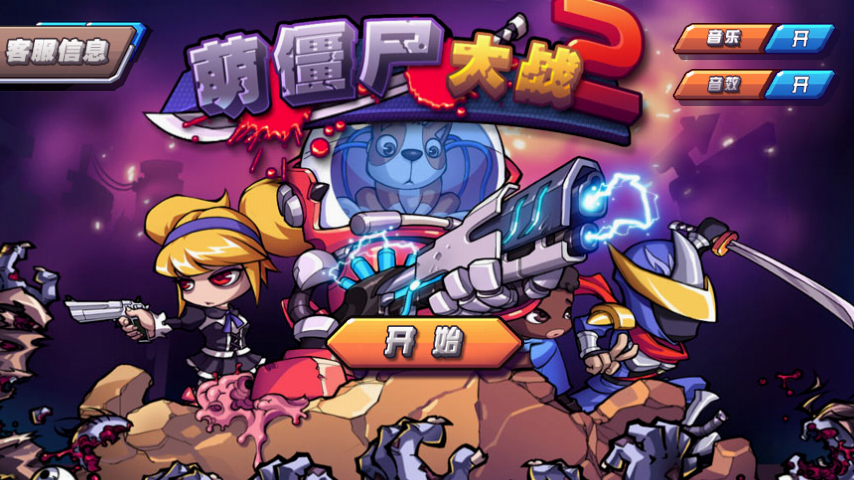
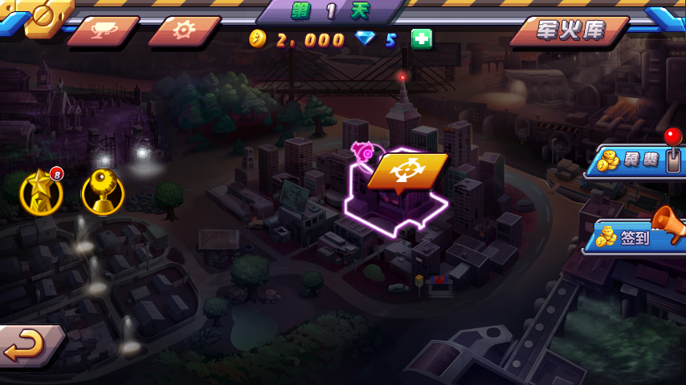
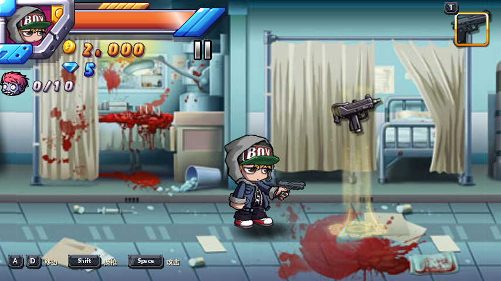
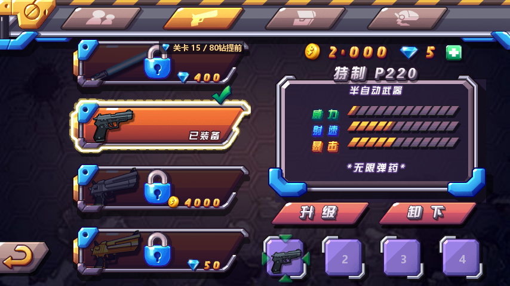
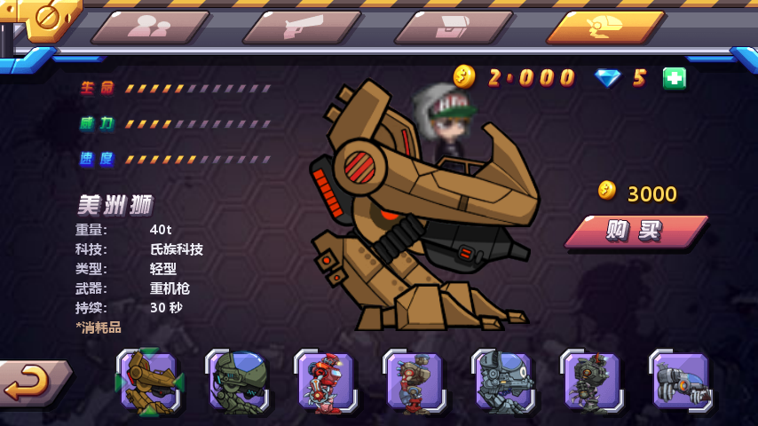
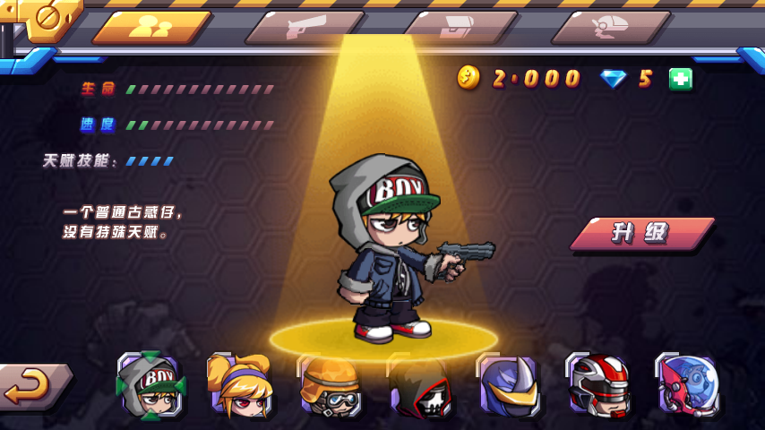

# Zombie Diary 2 · 萌僵尸大战2 — Python 复刻



《Zombie Diary 2》（《萌僵尸大战2》）的 Python / pygame 单机复刻。逻辑与数值依据原版数据表和 `libezjoygame.so` 反编译结果重建，固定 854×480 逻辑分辨率，桌面运行。

---

## 免责声明

本项目与 EZJOY LIMITED 及原作其他权利方不存在隶属、授权或合作关系。

1. 本项目仅用于个人学习，不进行商业分发，不对原作主张任何知识产权。
2. 游戏名称、角色、美术、UI、动画、音乐及剧情文本的著作权归原作权利人所有。原作由 EZJOY LIMITED 发布（包名根 `com.ezjoy.feelingtouch`，原生库 `libezjoygame.so`）。仓库内素材未取得第三方使用授权。
3. 国行 APK 由中国移动游戏渠道签名并接入其计费 SDK（见[国内发行渠道](#国内发行渠道)）。该渠道关系不构成著作权转让或授权。
4. 仓库内贴图、音频、字体不得用于商业用途、付费分发、应用商店上架或广告变现。
5. 权利人提出下架要求时，将删除相应资源或整个仓库。
6. 仓库不含原版 APK，不提供绕过正版校验的方法。
7. 代码按现状提供，使用风险由使用者自行承担。
8. 代码由 DeepSeek V4.1 Flash、MiniMax 3.1 Flash、HY4 Std、Kimi K3.1 Pro 辅助生成。虽经人工审查，仍存在未修复的缺陷。

---

## 目录

- [免责声明](#免责声明)
- [原作背景](#原作背景)
- [国内发行渠道](#国内发行渠道)
- [版权归属](#版权归属)
- [代码状态](#代码状态)
- [截图](#截图)
- [功能](#功能)
- [运行环境](#运行环境)
- [安装与运行](#安装与运行)
- [操作](#操作)
- [项目结构](#项目结构)
- [验证](#验证)
- [已知问题](#已知问题)
- [资料来源](#资料来源)

---

## 原作背景

| 时间 | 事件 |
|---|---|
| 约 2012 | EZJOY 推出《Zombie Diary（萌僵尸大战）》，横版萌系僵尸射击 |
| 2013 年底 – 2014 年初 | 续作《Zombie Diary 2》上线 App Store，随后登陆 Google Play / Amazon Appstore |
| 2014 | 版本更新加入 minigun、火焰喷射器、更多关卡、Game Center 成就、iCloud 存档 |
| 2014 – 2015 | 部分市场把商店标题更新为 *Zombie Diary 2: Evolution* |
| 约 2016 – 2017 | EZJOY 新品节奏放缓，部分商店页面下架或迁移；未见公开的收购或解散公告 |

原版为横版站桩射击：左右移动、按住开火、按波次刷怪。可升级武器 20 余把，角色解锁，生命 / 速度 / 装甲三条独立升级线，机甲与飞行武器作为消耗品召唤，任务分为击杀、限时、距离、护送、守卫、收集几类。

开发商主体在商店页记作 EZJOY LIMITED（部分渠道写作 EZJOY），据 APK 与商店信息为香港注册公司，活跃期约 2011–2017。游戏内法务文本为 `Copyright © EZJOY LIMITED. All Rights Reserved.`。成立时间、创始人、注册编号、当前存续状态均无可引用的登记材料，表中不作补充。

> 维基百科暂无《Zombie Diary》或 EZJOY 的独立条目。上表依据商店元数据、APK 字符串与第三方归档整理；工商信息以香港公司注册处、中国版权保护中心的登记为准。

---

## 国内发行渠道

国行包 `com.ezjoy.feelingtouch.zombiediary2China`（`versionName=8.8`、`versionCode=888`）由中国移动游戏渠道发行。该渠道当时称「中国移动游戏基地」/「和游戏」，后随中国移动基地公司化整合并入咪咕体系。

APK 内可直接读到的信息：

| 项 | 值 |
|---|---|
| 签名证书主体 | `CN=MGame, O=CNMobile, OU=MGame, L=Nanjing, ST=JS, C=CN` |
| 签发者 | `CN=CMCA Code Signing CA, O=CMCA, C=CN` |
| 有效期 | 2013-07-29 → 2015-07-29 |
| 签名文件 | `META-INF/MGame.RSA` / `MGame.SF` |
| 计费资源 | `assets/mmiap/`，75 个文件 |
| 代码标识 | `Lcom/chinaMobile/MobileAgent;`、`SmsPayCMCC_GC` / `SmsPayCMCC_MM`、`CMCC_GC` / `CMCC_MM` |

`CNMobile` 即中国移动，`L=Nanjing, ST=JS` 指设在南京的游戏基地，`mmiap` 是中国移动应用内计费 SDK。

上述信息可确认两点：EZJOY 是原作的开发与版权方；这份国行 APK 由中国移动游戏渠道签名、接入其计费 SDK 并发行。

渠道合作的合同性质无法确认。未检索到正式授权公告，EZJOY 与中国移动之间是独家代理、联合运营还是单纯渠道分发无据可查；签约公司的工商全称，以及 2014 年成立的咪咕文化是否接续了这份 2013 年签名包的合同关系，均缺少材料。公司沿革与当年的代理合同并非同一事项。

如需认定法律意义上的发行主体，应查阅 2013–2015 年的游戏媒体通稿、咪咕游戏公告、国家版权局软件著作权登记或渠道协议原件；APK 本身只能说明签名与计费通道。

---

## 版权归属

| 内容 | 权利方 |
|---|---|
| 游戏整体、名称、角色、美术、UI、动画、音乐音效、剧情 | EZJOY LIMITED（据商店与 APK 版权串） |
| 本仓库的 Python 代码 | 本项目作者 |
| 本仓库内的素材文件 | 不属于本项目，仅为研究目的随代码附带 |

---

## 代码状态

这是未完成版本，不是最终版。能跑通主流程（主菜单 → 地图 → 战斗 → 结算 → 军火库），但存在大量已知缺陷，见[已知问题](#已知问题)；界面与数值仍有未对齐原版的部分，后续不保证继续维护。

规模：79 个 Python 文件、约 3.16 万行；去除 `.git` 后目录约 36 MB，其中 `assets` 21 MB、`data` 404 KB、`fonts` 9.3 MB。

仓库不包含测试脚本、探针、截图工具和 `.vscode/` 配置，clone 后只能直接运行游戏，无法执行批量回归（见[验证](#验证)）。

最近一次完整回归在 2026-11-06、仓库外工作区完成：`compileall` 通过，76 个测试脚本全部通过，133 关逻辑跑通，地图稳态与原版参考帧逐像素一致率约 92.7%。这些脚本未随仓库发布，当前 clone 无法复现。`t_all_levels.py` 仅验证关卡逻辑可走完，不代表初始装备可以通关。

当前代码在本机 Python 3.9.13 + pygame 2.6.1 下 `compileall` 通过；无头渲染主菜单、世界地图、军火库与仓库内预览图抽样比对差异分别为 0%、0.98%、0.05%，战斗需推进若干帧才能对齐，抽样差异约 7%。上述检查只覆盖渲染和加载，不代表玩法没有缺陷。

---

## 截图

截图由当前代码无头渲染生成，854×480 逻辑尺寸，`SDL_VIDEODRIVER=dummy`。

| | |
|---|---|
| **主菜单**<br> | **世界地图**<br> |
| **战斗（第 1 关）**<br> | **军火库 · 武器**<br> |
| **军火库 · 机甲**<br> | **军火库 · 角色**<br> |

---

## 功能

- 主菜单 → 世界地图 → 关卡选择 → 战斗 → 结算 → 关卡推进
- 士兵移动、开火、朝向；Boss
- 任务类型按 `level_list.xml` 分 10 种：击杀 / 限时击杀 / 距离 / 限时距离 / 守卫 / 护送 / 限时护送 / 收集 / 限时收集 / 纯计时
- 19 种僵尸（`zombies/zombie_1..19.xml`）+ 4 个 Boss（`boss_1..4.xml`）
- 30+ 把武器（`level/upgrade.xml` 里 30 把）：含近战、泡泡、激光、声波、火箭、榴弹、闪电等特效；每把 4 档升级（等级号 0–3）
- 8 台机甲（`weapon/mech_1/3/4/5/7/8/9/10.xml`），属性运行时读 `weapon/mech_N.xml`；`mech_7` 是自动炮塔，不变身
- 治疗、护盾、力量、速度、空袭、飞行武器（`game/battle_abilities.py` 的 `ABILITY_DEFS`）
- 军火库四个页签，金币 / 钻石双货币
- 本地 JSON 存档：金币、钻石、关卡进度、武器等级、角色等级、机甲数量、每日任务、成就
- 签到、每日任务、成就、老虎机、僵尸商店、设置、暂停、复活、结算
- 键盘与鼠标操作（屏幕虚拟按键可开关），主菜单 / 地图 / 关卡选择 / 军火库全键盘导航，按钮音效与按角色区分的受伤 / 台词 / 枪声

与原版的差别：原版是移动端触屏，这里在桌面跑；原版联机、内购、广告相关功能没做（服务器早已下线），顶栏钻石旁的「+」（原充值入口）改成点开本地金手指面板手动输入金币 / 钻石；本地缺几张原版贴图，相关位置用系统字体替代。

---

## 运行环境

| 项 | 要求 |
|---|---|
| 操作系统 | Windows 10/11（开发与验证平台）。Linux / macOS 理论上可跑，未完整验证 |
| Python | 3.9 以上即可（实测 3.9.13；早期记录用 3.12.10 也正常） |
| pygame | 2.6.1（SDL 2.28.4） |
| 内存 | 512 MB 以上可用 |
| 磁盘 | 约 35 MB |
| 显示 | 854×480 窗口，可切全屏 |
| 字体 | 界面文字取 `Microsoft YaHei`（微软雅黑），缺失时退到 pygame 内置字体；非 Windows 平台需自备中文字体，否则中文会显示为方块 |

运行依赖只有 pygame。`game/zombie_sprite.py` 的 `edge_offset()` 内部会 `import numpy`，但该函数当前没有调用点，正常游玩不会触发；离线像素比对脚本另需 numpy。

存档写在仓库同级目录的 `save_data/save.json`，不在仓库内部。首次启动自动创建，删除该文件即重置进度。崩溃日志写入同级的 `cache/crash_<时间>.log`。

---

## 安装与运行

```bash
git clone <仓库地址> ZombieDiary2python
cd ZombieDiary2python
```

Windows：

```bash
python -m venv .venv
.venv\Scripts\activate
pip install pygame==2.6.1
python main.py
```

Linux / macOS：

```bash
python3 -m venv .venv
source .venv/bin/activate
pip install pygame==2.6.1
python3 main.py
```

首次启动会在仓库同级目录创建 `save_data/save.json`，删除该文件即重置存档；崩溃日志写入同级 `cache/`。仓库目录内不产生运行时文件（`sys.dont_write_bytecode` 已关闭 `.pyc` 生成）。

无头运行（截图 / 自动化）：

```bash
SDL_VIDEODRIVER=dummy SDL_AUDIODRIVER=dummy python main.py
```

PowerShell：

```bash
$env:SDL_VIDEODRIVER="dummy"; $env:SDL_AUDIODRIVER="dummy"; python main.py
```

用入口自带的截图参数渲染单张画面（不需要额外脚本）：

```bash
python main.py --shot menu docs/preview/01_menu.png
```

第一个参数是场景名，可选 `menu`、`map`、`battle`、`shop`，以及 `level`、`daily_reward`、`achievement`、`user_guide`、`splash`、`exp_weapon`、`failed_weapon`、`zombie_shop`、`equip_remind`、`slot`、`result_win`、`result_lose`；第二个参数是输出路径，省略则存为 `py_<场景>.png`。

---

## 操作

| 按键 | 功能 |
|---|---|
| `A` / `D`（或 `←` / `→`） | 左 / 右移动 |
| `Space` | 开火 |
| `1` `2` `3` `4` | 切换四个武器槽 |
| `Shift` | 顺序换枪（`↑` / `↓` 也能换） |
| `Q` `E` `R` | 使用三个技能道具 |
| `X` | 使用护甲类道具（护盾 / 装甲包） |
| `C` | 装备 / 召唤机甲 |
| `↑` `↓` `←` `→` | 界面导航 |
| `Enter` | 确认 |
| `F11` | 切换全屏 |
| `Esc` | 返回 / 暂停 |
| `P` | 战斗里退回世界地图 |

鼠标可直接点界面按钮。战斗中的屏幕虚拟按键（左下左 / 右移动、右下开火）默认隐藏，在设置里关掉「隐藏触屏」才显示。设置页还能切「按键模式」「键位提示」，并给左移 / 右移 / 攻击、武器槽 1–4、道具 1–3、护甲、机甲逐项改键，改完自动存盘。`F11` 全屏、`P` 退回地图是固定的，不受改键影响。

---

## 项目结构

```
.
├── main.py                     入口；窗口与主循环；--shot 截图
├── app/                        应用层：场景调度与输入
│   ├── core.py                 App 主体，场景切换、渲染分发
│   ├── input.py                键鼠分发，命中判定
│   ├── keynav.py               全键盘导航焦点框
│   ├── key_items.py            各界面可聚焦矩形清单
│   ├── dialogs.py              弹窗装配
│   ├── constants.py            全局常量：UI 命中矩形、节点隐藏表
│   └── scene_*.py              四个场景：map / shop / battle
├── engine/                     引擎层，与游戏内容无关
│   ├── res.py                  资源路径与图片缓存
│   ├── scene.py                节点树渲染
│   ├── skel.py                 骨骼动画
│   ├── fonts.py · bmpfont.py · gridfont.py
│   │                           系统字体缓存、位图字体、网格数字字体
│   ├── audio.py                音乐与音效
│   ├── name2icon.py            资源名 → 贴图映射
│   └── feedback.py             音效与震屏反馈
├── game/                       业务层，59 个模块，按前缀分类
│   ├── battle*.py              战斗主循环、子弹、背景、召唤物、技能
│   ├── dialog*.py ×15          各类弹窗：暂停、设置、升级、商店、签到…
│   ├── shop*.py ×7             军火库：页签、面板、货币、卡片
│   ├── map*.py ×4              世界地图：任务点、按钮、灯光、聚焦
│   ├── zombie_*.py · hostage_sprite.py
│   │                           僵尸与护送目标的骨骼渲染
│   ├── save.py                 存档，对齐 EzGameData 语义
│   └── …                       武器表、成就、老虎机、结算、复活等
├── assets/
│   ├── images/                 贴图，按原版卷内路径组织
│   └── raw/                    原版数据表与音频
│       ├── level/              关卡、升级表、机甲与士兵参数
│       ├── weapon/             30 把武器 + 8 台机甲
│       ├── zombies/            19 种僵尸 + 4 个 Boss
│       ├── config/             士兵、机甲、护送者骨骼配置
│       └── music/ · sounds/    音乐与音效
├── data/                       节点树、文本表、资源映射（11 个 JSON）
├── docs/preview/               README 截图
├── fonts/simhei.ttf            字体文件；代码中无引用，见运行环境
├── .gitignore
└── README.md
```

依赖方向单向：`app` → `game` → `engine`，`engine` 不反向引用业务代码。所有数值从 `assets/raw/` 的 XML 读取，不在 Python 中硬编码。

---

## 验证

语法检查：

```bash
python -m compileall -q game app engine main.py
```

批量回归脚本（`run_all_tests.py`、`t_all_levels.py` 等）未随仓库发布，clone 后无法直接运行；上文 76/76 的结果来自仓库外的工作区。若要在仓库内建立回归，需要把这些脚本拷入后再执行：

```bash
python t_all_levels.py
```

仓库内可直接执行的检查只有 `compileall` 与截图渲染，能确认代码可加载、资源路径正确，但不能证明玩法无缺陷：

```bash
python main.py --shot map py_map.png
```

注释统一用 `#` 单行，不使用三引号块注释。

---

## 已知问题

以下按代码当前行为整理，已修复的不再列出。

军火库 · 角色页：

属性条只画两行（生命、速度），第三行是固定的天赋技能占位（4 格写死为 4 点亮），并非角色的装甲值。原版第三行读的是第三条升级线，此处未接入。

军火库 · 机甲页：

1. 属性条取 `mech_actors.xml` 的 0–12 档位，战斗侧用的是 `weapon/mech_N.xml` 的真实数值（血量 1250 一类），两处口径不同。
2. `mech_7` 在战斗中召唤为自动炮塔、玩家不变身，商店页仍按普通机甲出售与装备。

存档：

1. 明文 JSON，无 schema 版本号与迁移逻辑，字段类型不符时静默丢弃该键并回默认值。
2. 文件损坏时重命名为 `.bad` 后回默认存档，无提示。

渲染：

1. 战斗场景出图与仓库预览图抽样差异约 7%，其余界面低于 1%；差异来自粒子与随机刷怪时序，非固定偏差。
2. 部分界面尚未与模拟器实拍逐像素对齐。

代码组织：

1. `game/battle.py` 2724 行未拆分；`game/gun_fx.py`（1591）、`game/shop_tabs.py`（1423）、`game/shopui.py`（1108）、`app/scene_battle.py`（1023）同样偏大。
2. `game/zombie_sprite.py` 的 `edge_offset()` 内 `import numpy`，当前无调用点；一旦启用即成运行依赖。

平台：

1. 非 Windows 需自行配置中文字体，否则中文显示为缺字方框。

---

## 资料来源

- 原作：EZJOY LIMITED — *Zombie Diary 2 / 萌僵尸大战2*
- 引擎：原版 cocos2d-x 2.1.4，本复刻 pygame 2.6.1
- 代码生成：DeepSeek V4.1 Flash、MiniMax 3.1 Flash、HY4 Std（混元）、Kimi K3.1 Pro
- 依据：App Store / Google Play 商店元数据、国行 APK 内字符串与签名证书、`libezjoygame.so` 反编译伪代码

核验入口：

- [Google Play 搜索](https://play.google.com/store/search?q=Zombie%20Diary%202&c=apps)
- [App Store 搜索](https://apps.apple.com/us/search?term=Zombie%20Diary%202)
- [APKPure 搜索](https://apkpure.com/search?q=zombiediary2)
- 香港公司注册处：<https://www.cr.gov.hk>
- 中国版权保护中心：<https://www.ccopyright.com.cn>

---

**Zombie Diary 2 · Python Revival**

用 Python 复刻一款已停服的老游戏。
